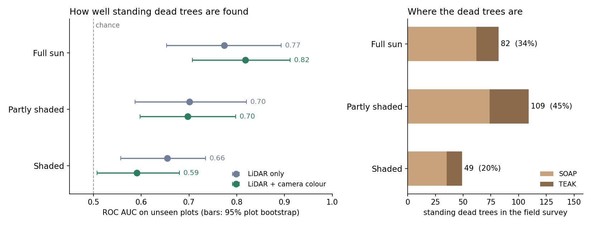

# deadwood-lidar

**Airborne LiDAR finds the standing dead trees that reach the light, and misses most of the rest.**
In two Sierra Nevada forests, a classifier built on NEON's airborne LiDAR and camera data separates dead
from live trees well when the tree stands in full sun (ROC AUC 0.82), and does little better than chance when
it stands in shade (0.59). Only about a third of the standing dead trees that field crews recorded were in full sun.



## Why this matters

Standing deadwood is a core biodiversity indicator: habitat for cavity-nesting birds, beetles and fungi, and a
term in carbon and fire-fuel accounts. Field counts don't scale, so it is increasingly mapped from airborne laser
scanning (ALS). This project asks how much of the standing deadwood on the ground such a map can actually see,
using the one open dataset that has field-labelled dead trees under ALS flights at scale.

## The finding

921 field-surveyed trees with known positions (240 standing dead), from five survey and flight pairings at
SOAP (2019, 2021, 2023) and TEAK (2021, 2023), two NEON forests in California's Sierra Nevada. Every score is on
plots the model never saw in training (cross-validation grouped by plot within each forest). NEON field crews
record each tree's canopy position, which splits the trees independently of the LiDAR.

| Canopy position (field) | Dead trees | ROC AUC, LiDAR only | ROC AUC, LiDAR + camera colour |
|---|---|---|---|
| Full sun | 82 (34%) | 0.77 (0.65–0.89) | **0.82 (0.71–0.91)** |
| Partly shaded | 109 (45%) | 0.70 (0.59–0.82) | 0.70 (0.60–0.80) |
| Shaded | 49 (20%) | 0.66 (0.56–0.74) | **0.59 (0.51–0.68)** |

Ranges are 95% intervals from a bootstrap that resamples whole plots (1,000 times).

- **With camera colour, the gap is clear.** Full-sun trees score higher than shaded ones in 998 of 1,000
  resamples (difference 0.07 to 0.37). The camera sees only the top of the canopy, so a dead tree under a live
  crown looks live.
- **With LiDAR alone, the gap points the same way but is not conclusive** (better in 93% of resamples). Laser
  pulses reach a little way into the canopy; colour does not.
- **The field data shows why.** At TEAK, the median surveyed tree is about 9 m tall but the tallest LiDAR return
  within 3 m of it is about 28 m: for most trees, dead or alive, the scanner mostly sees a neighbour's crown.

What this means in practice: a deadwood map made from the air is a map of canopy deadwood. Totals of standing dead
trees per hectare built from it will undercount the snags under the canopy, here roughly two thirds of them.

## The model, on one flight

On a single flight (SOAP 2023: 220 trees, 39% dead, 15 plots), the signal is structural:

| Feature group | Features | ROC AUC | Average precision |
|---|---|---|---|
| All LiDAR | 23 | 0.81 | 0.80 |
| Density | 3 | 0.80 | 0.78 |
| Return structure | 3 | 0.78 | 0.78 |
| Intensity | 6 | 0.68 | 0.71 |
| Shape | 4 | 0.71 | 0.63 |
| Height | 7 | 0.57 | 0.45 |

Foliage splits a laser pulse into several returns and fills a volume with points; a bare snag does neither. These
signals don't need radiometric calibration, which is what makes a model portable between sensors. Intensity, the
sensor-dependent group, is not needed.

## Honest limitations

- **Pooling flights costs accuracy.** Point density varies a lot between flights (3 points/m² at SOAP in 2019,
  11.5 in 2023), so density and intensity features are divided by each flight's median. Even so, pooled scores
  (ROC AUC about 0.72) are below the single-flight 0.81.
- **TEAK is hard**: 5 plots, mostly understory trees under tall conifers (ROC AUC 0.56 to 0.64).
- **Stem positions are reconstructed**, from distance and bearing to surveyed plot points. A metre or two of error
  matters when the neighbourhood is 3 m.
- **Classification, not detection.** Stem locations come from the field survey; finding stems from the point
  cloud alone is a separate problem.
- **Two forests, 240 dead trees.** The direction is consistent, the size of the effect is uncertain.

## Data

[NEON](https://www.neonscience.org/) woody vegetation structure (`DP1.10098.001`, `plantStatus`, `canopyPosition`,
stem mapping) and discrete-return LiDAR point clouds (`DP1.30003.001`, colorized with the co-acquired camera).
Downloads need a free NEON account and API token (since June 2026), read from `~/.neon_token` or `NEON_TOKEN`.

Data: National Ecological Observatory Network (NEON), operated by Battelle and funded by the U.S. National Science
Foundation, licensed [CC BY 4.0](https://creativecommons.org/licenses/by/4.0/).

## Run it

```bash
pip install -e ".[dev]"
pytest                                   # 21 tests, no network or data needed
python scripts/build_site.py SOAP --veg 2023-09 2023-10 --lidar 2023-06 2023-07
python scripts/build_site.py SOAP --veg 2021-10 2021-12 2022-01 --lidar 2021-07
python scripts/build_site.py SOAP --veg 2019-06 2019-07 2019-09 2019-10 --lidar 2019-06
python scripts/build_site.py TEAK --veg 2023-08 --lidar 2023-07
python scripts/build_site.py TEAK --veg 2021-09 2021-11 2021-12 --lidar 2021-07
python scripts/visibility.py             # results/visibility.json
python scripts/visibility_bootstrap.py   # results/visibility_bootstrap.json
python scripts/figures.py                # figures/visibility.png
python scripts/train.py data/features_SOAP_2023.parquet   # single-flight ablation
```

`build_site.py` streams one 1 km LiDAR tile at a time, keeps only the points within 15 m of a surveyed tree and
deletes the full tile, so a laptop with little free disk can run it.

## Layout

```
src/deadwood/
  neon.py        NEON API client (token), plantStatus -> label, stem coordinates
  dataset.py     LAZ loading, ground normalisation, neighbourhood extraction
  features.py    23 LiDAR features in 5 groups, plus crown colour (kept separate)
  model.py       gradient boosting, grouped CV, ablation
scripts/
  build_site.py            field labels + LiDAR crops + feature table for one site and year
  visibility.py            the canopy-position result
  visibility_bootstrap.py  plot-level confidence intervals
  figures.py               README figure
  train.py                 single-flight evaluation and ablation
tests/                     feature behaviour and an end-to-end run on a synthetic LAZ tile
results/                   JSON and text outputs behind every number above
```

## Licence

Code: MIT.
